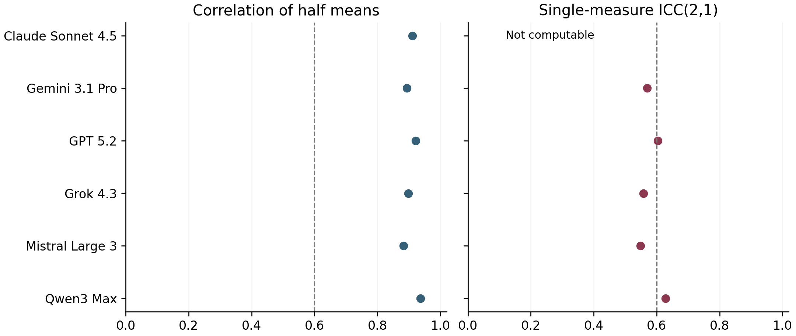
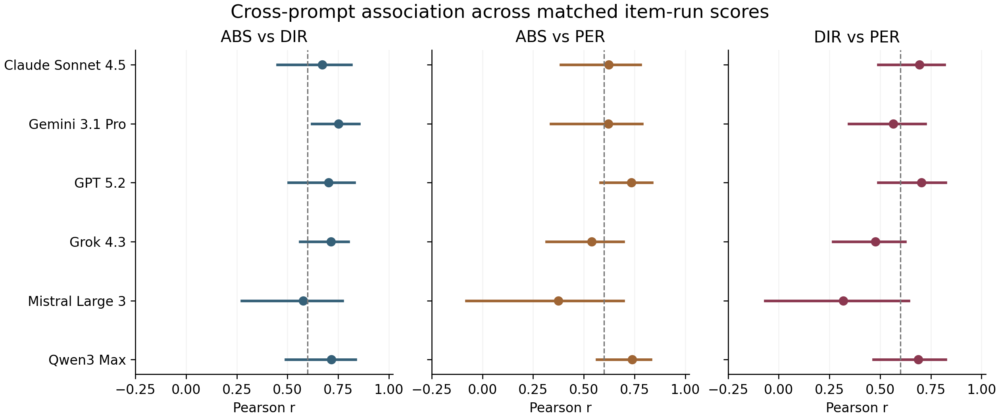
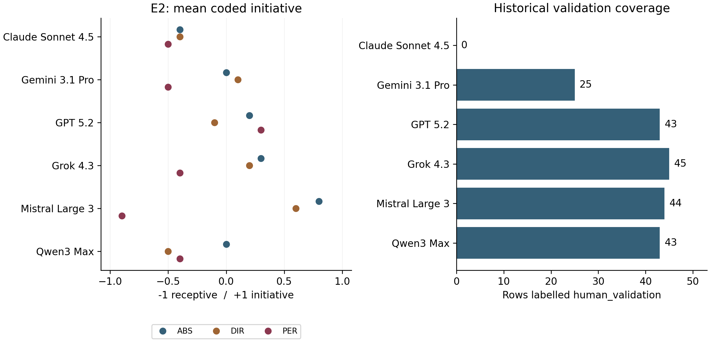

# Scorable yet context-sensitive: a preliminary audit of prompt-conditioned response profiles in six language models

**SoulBench SNAP v3.1 | Working preprint manuscript | 6 September 2026**

**Authors and affiliations: TODO - to be supplied and approved by the research owner.** Target venue: undecided. This document is a local draft for scientific review and has not been submitted or published.

## Abstract

Behavioral profiles derived from language-model responses require both a reproducible scoring procedure and a defensible account of variation across contexts. We report a retrospective audit and computational reproduction of SoulBench SNAP v3.1, a compact feasibility study comprising 2,700 single-turn responses from six model endpoints. Fifteen bespoke English-language items were administered under three system-message conditions and a ten-run schedule that rotated scenario, formulation, and nominal temperature. Responses were coded on item-specific -1/0/+1 scales, with a separate refusal category, by two language-model judges and a disagreement-resolution procedure. Unweighted inter-judge Cohen's kappa was 0.7509 across 2,695 complete pairs; all 2,700 responses had a final score. Correlations between mean profiles from scheduled runs 1-5 versus runs 6-10 ranged from 0.8827 to 0.9371, but the minimum computable single-measure ICC was 0.5486 and the weakest cross-system-prompt correlation was 0.3189, both below the historical 0.60 decision threshold. The retained and reproduced POC decision is **FAIL**. A historical 200-row validation sample yielded agreement with final scores of kappa 0.5789, but excluded Claude Sonnet 4.5 and does not establish representative human validation. Exploratory diagnostics show that aggregation can obscure response-level differences and that an introspective system prompt is associated with large changes in a selected initiative item. These results support a bounded measurement-feasibility finding, not intrinsic personality, model rankings, or population-level invariance. The accompanying scripts reproduce aggregate tables and figures from fingerprinted inputs without new model calls.

**Keywords:** language-model evaluation; behavioral measurement; prompt sensitivity; inter-rater agreement; reproducibility; negative results.

## 1. Introduction

A language model may repeatedly recommend caution, accommodate a user's preference, or take initiative in an ambiguous interaction. Such regularities are potentially useful objects of measurement. However, a score assigned to an output is not by itself evidence that a model possesses a psychological trait. It may reflect the scenario, the explicit instruction, the response format, the scoring rubric, the model endpoint, or interactions among these features. A useful benchmark must therefore state what is held constant, what is varied, and which level of stability its statistics describe.

The motivating question for SNAP is deliberately operational: under a controlled set of ambiguous situations, can free-form outputs be coded consistently, and do the resulting profiles remain sufficiently stable across specified prompting conditions to justify a larger campaign? The study does not test consciousness, internal values, authentic preferences, or psychological equivalence between models and people. The words personality and morality in the input-file taxonomy identify sources of item inspiration. They do not establish latent constructs.

The distinction matters because feasibility criteria can disagree. Judges may agree on how to code a response while different prompts induce different responses. Likewise, a high correlation between two vectors of item means can coexist with inconsistent individual outputs. An aggregate pattern can be dominated by persistent differences between items rather than by stability within a given item. Reliability, agreement, robustness to a manipulation, and construct validity should therefore be reported separately.

This paper contributes a reproducible account of an existing, completed pilot rather than a new model campaign. First, it audits data lineage, condition coverage, score resolution, and the connection between archived reports and executable analyses. Second, it preserves the pilot's failed scaling decision while explaining which numerical criteria produced it. Third, it adds explicitly exploratory aggregation, uncertainty, scoring-source, and truncation diagnostics to guide a subsequent design. A negative feasibility outcome is useful here: it identifies requirements that should be resolved before more data are collected using the same instrument.

The manuscript is retrospective. Historical protocol and configuration files contain explicit decision rules, but the materials inspected do not establish a dated public preregistration or prove that every threshold was frozen before data inspection. We call these **historical protocol checks**. We reserve confirmatory language for future analyses whose hypotheses, estimands, decision rules, and exclusion policies can be registered before their data are observed.

## 2. Related work and scope

Psychometric assessment of language models has produced evidence of both conditional regularity and important validity limitations. Huang and colleagues evaluated the reliability of psychological scales across varied instructions and other settings, while explicitly separating reliability from downstream validity [1]. Serapio-García and colleagues developed a framework spanning reliability, convergent and discriminant validity, criterion-related evidence, and prompted shaping of generated behavior [2]. These studies motivate treating validation as a sequence of empirical questions. Their results do not validate SNAP's custom items, score poles, or sample.

Context also changes the object being measured. CAPE incorporates prior conversational interactions and reports context-dependent response patterns [3]. SNAP instead uses isolated single-turn exchanges and varies the system message. The two designs address different sources of variation; stability under one does not imply stability under the other. We do not adopt ontological interpretations of model personality from the vocabulary of a cited paper.

A recent psychometric critique by Zierahn and colleagues questions whether human Big Five inventories measure an equivalent construct in LLMs, including their between-model differentiation and factor structure [4]. We cite its version 2 of 2 September 2026; the current author record differs from older search-index versions. This critique reinforces the need to avoid transferring human construct labels solely because a model can produce questionnaire-like responses. SNAP's free-form scenarios change the measurement surface, but do not remove the need for construct validation.

Automated judges make open-response evaluation practical. Zheng and colleagues investigate agreement with human preferences and document biases including verbosity, position, and self-enhancement in LLM judging [5]. Their task concerns assistant preference evaluation, whereas SNAP uses item-specific coding. Consequently, agreement in that benchmark cannot be imported as a quality guarantee for the two SNAP judges. Independent model calls also do not imply statistically independent errors, independent training data, or immunity to shared stylistic preferences.

The moral item labels are inspired by the five-domain framework studied by Graham and colleagues [8]. SNAP does not administer the validated Moral Foundations Questionnaire: it uses one bespoke scenario pair per named domain, often contrasting competing reasons or actions. A positive code is not a common measure of moral goodness or endorsement strength across items. Similarly, two custom items per Big Five-inspired dimension are insufficient to claim replication of a five-factor measurement model.

Methodologically, Cohen's kappa quantifies nominal agreement beyond that expected from the observed marginal distributions [6]. ICCs additionally require an explicit choice of model, single versus average measurement, and consistency versus absolute agreement [7]. These distinctions are central here because the retained implementation uses single-measure ICC(2,1), whereas its split-half statistic correlates averages. This focused review uses primary papers and their author or publisher records checked on 6 September 2026. It is not a systematic literature review or an exhaustive claim of novelty.

## 3. Materials and methods

### 3.1. Evidence boundary and provenance

The scientific reference comprises a campaign SQLite database, a separate clean validation database, the coded validation CSV, the current configuration, and versioned result reports. The inherited Git base is `eae718894aafad84e61febc2848dc6300c25403b`. The research owner's checkout also contained later documentation and sampling-code changes. These were copied into an isolated worktree and fingerprinted before new manuscript work. The original `src/db.py` and `tests/test_db.py` changes were preserved without editing. The sampling correction affects future exports and does not retrospectively replace the historical validation sample.

The main database contains 2,700 rows with dataset identifier `snap_poc_v3_1_2026-04`, protocol version `3.1`, item version `items_v1_2026-04`, and condition block `main`. Despite the April dataset label, response timestamps span **12-16 May 2026 UTC**. The retained decision report is dated 22 May 2026. These are different provenance fields, not interchangeable dates of collection or registration. Response timestamps are used for observation chronology: the Mistral metadata start time reflects a resumed collection and occurs after its earliest retained response.

All source SQLite inspection uses read-only connections. Before analyses involving the repository's database wrapper, a consistent SQLite backup is made into a disposable private directory, together with a configuration snapshot. This is necessary because opening `SoulBenchDB` initializes or migrates schema, and the human-kappa command writes derived values. Fresh reports and the decision are generated from the same backup/configuration state. No response is recollected or rescored. Source-file hashes are compared before and after reproduction.

The audit checks distinct trial IDs, exact condition coverage, stored prompts against configuration, CSV labels and response context against the validation database and campaign, and equality of the two databases' response tables. It exports aggregate metrics, not raw responses or coder justifications. A record labelled `human_validation` is evidence of a stored label and its source tag; coder identity, expertise, independence, and blinding require separate documentation.

### 3.2. Experimental units and design

Each collected observation is one isolated single-turn exchange: an optional system message followed by a user scenario and question formulation. The design has six configured endpoints, 15 items, three system-message conditions, and ten scheduled runs: 6 x 15 x 3 x 10 = 2,700 responses. Each model contributes 450 responses, each system condition 900, and each model-item-system cell ten. Ten personality-inspired items yield 1,800 observations; five moral items yield 900.

The 15 items are bespoke English-language materials. The personality-inspired families are Openness, Conscientiousness, Extraversion, Agreeableness, and Neuroticism, with two items each. The moral labels are Care/Harm, Fairness/Cheating, Loyalty/Betrayal, Authority/Subversion, and Purity/Sanctity, with one item each. All exact scenarios, formulations, and rubric definitions remain in the fingerprinted YAML inputs.

The schedule below is repeated across models, items, and system conditions. It rotates scenario, formulation, and nominal temperature; these factors are not exhaustively crossed. Each unique nominal scheduled combination occurs once within a model-item-system cell. The rotated design is not a systematic fixed-configuration test-retest study. GPT-5.2 provides an opportunistic exception: omission of temperature and top-p yields 180 pairs with identical reconstructible request messages and configured generation parameters (run pairs 1/7, 2/8, 3/9 and 4/10). The endpoint and generation limit are reconstructed from code/configuration rather than complete historical per-call payload logs; backend identity and provider execution equivalence are not established. The other five models have no repeated reconstructible requests after accounting for their transmitted temperature. Collection order is shuffled with a recorded seed per model; the seed is for condition order, not proof of deterministic provider inference. Scheduled halves therefore do not denote early and late collection periods.

**Table 1. Deterministic run schedule from `config/protocol.yaml`.**

| Run | Scenario | Formulation | Nominal temperature |
| --- | --- | --- | --- |
| 1 | base | F1 | 0.0 |
| 2 | variation | F2 | 0.5 |
| 3 | base | F3 | 1.0 |
| 4 | variation | F1 | 0.0 |
| 5 | base | F2 | 0.5 |
| 6 | variation | F3 | 1.0 |
| 7 | base | F1 | 0.5 |
| 8 | variation | F2 | 1.0 |
| 9 | base | F3 | 0.0 |
| 10 | variation | F1 | 0.5 |

### 3.3. System conditions and model configuration

`SP_ABS` sends no system message. `SP_DIR` explicitly frames the exchange as a research evaluation and asks for honest, clear responses. `SP_PER` induces a contemplative, introspective posture and explicitly relaxes ordinary helpfulness. The latter therefore has substantive instructional content. Treating it as a merely superficial paraphrase is an assumption being challenged by the pilot, not an established property of the manipulation. Exact system messages appear in the supplementary material.

**Table 2. Configured collection endpoints for the historical campaign.** Endpoint names are configuration evidence, not a claim of current service availability or an immutable resolved model revision.

| Label | Configured OpenRouter identifier | N |
| --- | --- | --- |
| Claude Sonnet 4.5 | anthropic/claude-sonnet-4.5 | 450 |
| GPT 5.2 | openai/gpt-5.2 | 450 |
| Gemini 3.1 Pro Preview | google/gemini-3.1-pro-preview | 450 |
| Qwen3 Max | qwen/qwen3-max | 450 |
| Mistral Large 3 | mistralai/mistral-large-2512 | 450 |
| Grok 4.3 | x-ai/grok-4.3 | 450 |

Generation was configured through OpenRouter with a maximum of 2,048 completion tokens and top-p 1.0 where supported. The row-level flags record that temperature and top-p were omitted for all 450 GPT 5.2 observations. Its nominal temperature cells therefore cannot be interpreted as manipulated sampling-temperature conditions. Recorded thinking settings describe configured provider behavior and were not experimentally manipulated. All six `collection_metadata.model_version` fields are missing. Collection dates differ by model, so model comparisons may additionally reflect time, backend, or service changes. There is no basis for treating the six endpoints as a random sample of all LLMs.

### 3.4. Coding, resolution, and validation records

The two configured judges are Claude Haiku 4.5 (`anthropic/claude-haiku-4.5`) and Kimi K2.5 (`moonshotai/kimi-k2.5`). The inspected scoring code supplies the item identifier, coding rubric, and response text; it does not explicitly add the collection model identifier or system-condition label. The response itself can nevertheless reveal style or identity. The current implementation requests temperature 0 and a 512-token scoring limit; Kimi's configuration disables explicit reasoning. Per-call historical judge payloads and immutable judge revisions are not recoverable from the retained scientific database alone.

Each judge returns an item-specific code, indicators, and a short justification. Numeric poles are -1, 0, and +1; `REFUS` is a separate nominal category, excluded from numerical profile analyses. Zero covers balance, conditionality, lack of a directional recommendation, and in some rubric wording unclassifiability. These cases should not be interpreted as one homogeneous psychological state. E1 directly incorporates response-length bands; E2 contrasts initiative with receptivity. Their labels are operational choices that can make style and helpfulness instructions affect the score.

Matching judge codes become the final score. Adjacent disagreements (+1 versus 0, or 0 versus -1) are assigned final score 0. Opposed poles and conflicts involving `REFUS` require manual adjudication. Five responses have no second-judge score and also received a manually adjudicated final score. Consequently, the populations for inter-judge agreement (2,695 complete pairs) and final-score analysis (2,700 resolved rows, including two refusals) differ.

The clean validation database contains 230 manual-verification rows: 30 tagged adjudication and 200 tagged human validation. Only the latter enter the reported validation kappas. The CSV contains 200 labels, all joined to the campaign and validation data for fidelity checks. The sample spans five models and excludes Claude Sonnet 4.5. The original exported CSV includes a `score_final` field, so blinding cannot be assumed from the file format. **TODO:** establish who supplied the historical human labels, how they were trained, whether they saw model/judge/final-score information, and whether more than one independent coder participated. The present audit does not supply new human labels.

### 3.5. Historical decision checks

The configured scaling checks are reported exactly as stored. Kappa below 0.50 fails; 0.50 to below 0.60 is borderline; 0.60 or above meets the target. Refusal rate must not exceed 0.10 and initial major-disagreement rate must not exceed 0.15. The minimum model ICC, minimum model split-half correlation, and minimum cross-system correlation each have a 0.60 threshold. These operational values are not universally validated scientific cutoffs.

The executable decision prioritizes a failing check over borderline or missing checks. It takes minima over available finite model statistics, so the ICC minimum uses five models when Claude's ICC cannot be computed. The absence of a value is not evidence that the omitted model passes. Completeness is assessed separately: `NOT_READY` denotes missing collection or unresolved scoring, whereas the present `FAIL` is produced after the configured campaign is complete. We preserve the historical logic and report its missingness limitation rather than modifying a threshold or exclusion to obtain a favorable result.

Local Git records provide some chronology: commit `0646789`, with author and committer timestamps of 10 May 2026, contains the same scheduled-run and decision-threshold mappings as the inspected current configuration, preceding the first retained responses on 12 May. The same schedule is present in `be15135` dated 24 April, although that earlier full threshold mapping differs. These mutable local records do not constitute independent, immutable preregistration and do not turn this retrospective audit into a prospective confirmation.

### 3.6. Statistical definitions and analysis status

For nominal inter-judge agreement we compute kappa = (p_observed - p_expected)/(1 - p_expected), using the empirical marginal category proportions and all complete judge pairs, including `REFUS`. Exact agreement is reported alongside kappa. Human-versus-judge1, human-versus-judge2, and human-versus-final agreement are separate quantities; the final score is derived from the judges and adjudication, not an independent reference rater. Supplemental linear and quadratic weighted kappas exclude any refusal pair because refusal is not an ordinal pole.

For each model, split-half Pearson correlation compares mean scores from runs 1-5 with mean scores from runs 6-10 across 45 item-system targets. It is a correlation of aggregates, without Spearman-Brown correction, and does not estimate an independent temporal test-retest correlation. The retained ICC selects Pingouin's `ICC2` statistic: a two-way random-effects, absolute-agreement, single-measure ICC(2,1), with targets defined by item and system condition and runs treated as raters. We independently verify its ANOVA formula on complete matrices. The deterministic, changing run schedule limits the interpretation of the random-rater assumption. No missing Claude scores are imputed and no targets are deleted to restore balance.

The historical cross-system statistic correlates numeric scores across matched item-run pairs, up to 150 pairs per model and condition pair. It is not a correlation of only 15 item means. Exploratory supplements additionally report Spearman correlation, correlation of paired item means, within-item centered correlation, exact agreement, and mean absolute score difference. Centering is descriptive; it is not a validated replacement gate.

For descriptive uncertainty, we reuse the inherited audited bootstrap helper with 5,000 replicates and seed 20260904. Cross-system and split-half intervals resample the 15 item blocks with replacement, retaining their runs and condition structure. Percentile 2.5th and 97.5th bounds are sensitivity summaries under an item-exchangeability assumption, not guaranteed population confidence intervals for a random item sample. The item set is small and purposive; the intervals do not cover endpoint drift, systematic judge bias, or selection of the weakest pair. The selected Mistral/E2 contrast also has an exploratory paired-run bootstrap. Its inherited sign-flip p-values are retained in machine-readable diagnostics only; exchangeability of deterministic schedule positions and post-selection calibration are not established.

Scenario and formulation tests compare factor-level averages within item-system targets using Wilcoxon and Friedman tests, respectively; temperature uses Friedman where the parameter was sent. We reproduce all 17 applicable per-model tests, then report an explicitly post-hoc Holm adjustment across that family. Marginal eta-squared is computed separately for each factor as between-group sum of squares divided by total sum of squares. These one-factor associations are neither additive variance components nor uniquely attributable causal contributions. The inherited exploratory mixed model is reproduced for provenance but its coefficient p-values are not used to validate hypotheses or pass the POC.

## 4. Results

### 4.1. Data completeness and scoring

The audit verifies 2,700 unique trials, all with final scores and no final error rows. It verifies the run schedule and stored prompting text against the inspected configuration. Final codes comprise **899 positive, 1,327 zero, 472 negative, and two refusals**. Numeric analyses therefore use 2,698 responses. These counts describe the retained final database, not the number of API attempts: retries, unsuccessful attempts before recovery, and provider billing cannot be reconstructed from the final row count.

There are 2,266 direct agreements, 404 automatically resolved adjacent disagreements, and 30 manual adjudications. Within the 2,695 complete judge pairs, 24 initially oppose positive and negative poles and one involves a type/refusal disagreement. The remaining five adjudications cover missing second-judge scores. Initial major disagreement is 24/2,695 = 0.89%; this denominator and event definition differ from 30/2,700 adjudications. No rows remain flagged for manual review.

**Table 3. Agreement populations and metrics.** The historical human-labelled sample has incomplete model coverage and undocumented coder independence. These kappas quantify stored-label agreement, not verified human ground truth.

| Comparison | Pairs | Exact agreement | Unweighted kappa |
| --- | --- | --- | --- |
| Judge1 vs judge2 | 2695 | 84.08% | 0.7509 |
| Historical human vs judge1 | 200 | 75.50% | 0.6234 |
| Historical human vs judge2 | 200 | 75.50% | 0.6304 |
| Historical human vs final | 200 | 72.00% | 0.5789 |

An exploratory item-level screen shows that aggregate judge agreement does not apply uniformly to all rubrics. Five of fourteen finite item kappas are below 0.60: A2 (0.4214), C1 (0.3271), M_AS (0.5446; 175 pairs), N1 (0.5212) and O1 (0.4869); the other listed items have 180 pairs each. E1 has +1 from both judges and as final score on all 180 responses. Its exact agreement is 100%, but kappa is undefined because expected agreement is also 100%; it offers no observed discrimination among models or system conditions in this corpus. These post-hoc diagnostics expose category prevalence and ceiling effects, without imposing a new item-level gate or recoding any response. Full counts and agreements appear in the supplementary review tables.

The final-score agreement with the historical validation labels is lower than agreement with either judge separately. This observation is compatible with the resolution policy changing the label distribution, but it does not identify that policy as the causal source of disagreement. Automatically assigning 404 adjacent disagreements to zero also means that the 1,327 zero scores are not all direct judge agreements on an ambivalent response. The validation sample is not suitable for unbiased six-model accuracy claims.

### 4.2. The historical scaling decision remains FAIL

**Table 4. Reproduced historical decision checks.** Minima use available values. The thresholds are historical rules, without a verified preregistration date.

| Check | Value | Rule | Status |
| --- | --- | --- | --- |
| Inter-judge kappa | 0.7509 | >=0.60 target; >=0.50 floor | PASS |
| Refusal rate | 0.0007 | <=0.10 | PASS |
| Initial major-disagreement rate | 0.0089 | <=0.15 | PASS |
| Minimum model ICC (5 available) | 0.5486 | >=0.60 | FAIL |
| Minimum model split-half (6) | 0.8827 | >=0.60 | PASS |
| Minimum cross-system r (18 pairs) | 0.3189 | >=0.60 | FAIL |

The complete campaign fails two numerical checks: minimum ICC and minimum cross-system correlation. This is a failure of the configured feasibility gate, not a malfunction of data processing and not a statistical proof that stable model behavior is impossible. Claude's missing ICC is an additional limitation that a minimum over available values does not resolve.

**Table 5. Reliability and lowest cross-system correlation by model.** All split-half statistics use 45 item-system targets. ICC is single-measure; split-half is a correlation between averages.

| Model | ICC(2,1) | Split-half r | Lowest cross-system r |
| --- | --- | --- | --- |
| Claude Sonnet 4.5 | Not computable | 0.9108 | 0.6240 |
| Gemini 3.1 Pro | 0.5701 | 0.8938 | 0.5654 |
| GPT 5.2 | 0.6033 | 0.9223 | 0.7033 |
| Grok 4.3 | 0.5582 | 0.8985 | 0.4767 |
| Mistral Large 3 | 0.5486 | 0.8827 | 0.3189 |
| Qwen3 Max | 0.6288 | 0.9371 | 0.6889 |

*Figure 1.* The dashed line marks the retained 0.60 rule in both panels. The left panel correlates means of five scheduled runs; the right panel describes single-measure absolute agreement across changing scheduled conditions. Their difference does not by itself diagnose a faulty statistic. Claude's two refusals leave an unbalanced numeric target-by-run matrix that the retained ICC implementation rejects.

### 4.3. Cross-system variation and aggregation

The weakest pair is Mistral Large 3, `SP_DIR` versus `SP_PER`: r = 0.3189 across 150 matched item-run pairs. Its exploratory item-block percentile interval is [-0.0672, 0.6413]. This broad interval reflects substantial uncertainty with only 15 item blocks and includes values on both sides of the 0.60 rule; it is not used to reverse the historical point-estimate decision. The correlation between the 15 paired item means is 0.5186, whereas within-item centered correlation is 0.0606. Exact paired-score agreement is 66.67% and mean absolute difference is 0.3733 on the -1 to +1 score scale.

*Figure 2.* Each point is the historical Pearson correlation over matched item-run scores; lines show 95% descriptive percentile intervals from 5,000 item-block resamples. Three Claude comparisons use 149, 148, and 149 pairs, respectively; the other comparisons use 150. The plot shows all 18 pairs to make selection of the minimum visible. The dashed line is the 0.60 historical gate, not a null hypothesis or simultaneous confidence boundary. Intervals are not adjusted for comparing or selecting pairs.

Across models, the lowest pairs do not invariably involve `SP_PER`: GPT 5.2's minimum is ABS versus DIR. Mistral also falls below 0.60 for ABS versus DIR (r = 0.5780). Thus, the observed pattern supports a particular concern about the introspective condition, while leaving additional sources of instability. A blanket claim that all variation is caused by `SP_PER` would overstate the evidence.

### 4.4. Selected item and data-quality diagnostics

In the selected Mistral/E2 cell, mean scores are 0.8 under ABS, 0.6 under DIR, and -0.9 under PER, each based on ten responses. The maximum range is 1.7 on a two-unit scale. The PER-minus-DIR mean difference is -1.5; its paired-run percentile interval is [-1.9, -1.1]. This is a descriptively large observed contrast. E2 was selected after examining the existing results, so its interval is not a selection-adjusted discovery claim. Figure 3 displays the same item for all six models and the full validation coverage pattern.

*Figure 3.* Left: means of ten final numeric E2 codes per system condition and model; higher values denote coded initiative. Dots are descriptive means, not trait estimates. Right: counts among the 200 rows tagged `human_validation`; Claude Sonnet 4.5 has zero. Neither panel establishes a causal mechanism or human-level construct validity.

Seventeen responses are flagged as truncated, all from Mistral and all at 2,048 recorded completion tokens. They were retained historically: 15 had direct judge agreement and two had adjacent disagreements, with no manual adjudication among these rows. This is 17/450 Mistral responses (3.78%). As an exploratory sensitivity analysis, removing truncated rows yields Mistral DIR-versus-PER r = 0.3189 across 149 complete pairs. The resulting coefficient remains below 0.60, but this selective removal changes the sample and is not a repaired confirmatory result.

Scoring-source sensitivity recomputes correlations using each judge's numeric codes before consensus. For Mistral DIR versus PER, judge1-only r = 0.3316 and judge2-only r = 0.3575. These alternatives describe the dependence of a behavioral summary on scoring choice; they do not change the reference final scores or imply that either judge is correct. Complete values for all models and pairs are provided in the supplementary CSV.

### 4.5. Rotated-factor and variance diagnostics

The unadjusted temperature tests for Gemini and Grok reproduce p = 0.0280 and p = 0.0211, respectively. Neither survives the post-hoc Holm adjustment across the 17 applicable scenario, formulation, and temperature tests; the smallest adjusted p is 0.3588. Scenario and formulation comparisons are not statistically persuasive in the retained per-model tests. Failure to reject is not evidence of equivalence or absence of meaningful effects: there is no prespecified equivalence margin, the factors are incompletely crossed, and power for a particular effect has not been established.

Marginal eta-squared is 0.4709 for item identity, versus 0.0025 for model and 0.0021 for system condition. These values summarize global mean separations across differently oriented item codes. They do not imply that item identity causes that percentage of a common latent personality variable, that model differences are absent, or that cross-condition interactions are negligible. The factorwise quantities are computed separately and must not be summed as a decomposition of uniquely explained variance.

The archived mixed model is exploratory despite the key name `confirmatory_lmm`. The implementation fits item-grouped random effects with run and model variance-component design columns evaluated within item groups; this is not a verified implementation of the globally crossed random effects suggested by the shorthand formula in historical prose. It also includes nominal GPT temperature categories even though temperature was omitted for that endpoint. Accordingly, convergence alone is not evidence of adequate specification, and the manuscript does not use its coefficient p-values as confirmatory findings.

### 4.6. Opportunistic repeated requests for GPT-5.2

The 180 reconstructed GPT-5.2 pairs give 142 identical final codes (78.89%), nominal kappa 0.6460 and Pearson r = 0.7440. No paired raw responses are strictly identical. Partners were stored on 12 May 2026 with absolute timestamp separations of 33.57 to 9,305.73 seconds (median 3,112.16 seconds). These are storage times after responses, not verified provider processing times. Two pairs have different recorded prompt-token counts despite matching stored messages; the available fields do not identify the cause. The result is an exploratory, same-day, single-endpoint check of reconstructed request repetition, not a replacement for a planned temporal retest, proof of equivalent provider execution, or a new passing decision.

## 5. Discussion

The core result is a separation between codeability and contextual robustness. On the retained score pairs, the judges produce reasonably consistent categorical coding under the project's historical target. Yet the feasibility gate fails because some response profiles vary too much across scheduled or system-message conditions under those same rules. A scalable pipeline and an interpretable failure can coexist. Reporting that conjunction is more informative than presenting agreement alone as validation of the instrument.

The introspective system message changes the task framing in a way that overlaps with what some rubrics measure. It relaxes ordinary helpfulness and direction, while E2 rewards launching proposals rather than waiting receptively. This alignment provides a plausible operational explanation for sensitivity in E2, but it is an interpretation of prompt and rubric content. Establishing mediation by response style would require a planned manipulation and blinded coding, not merely a large selected contrast. Removing `SP_PER` after seeing failure would redefine the robustness claim. A future protocol should instead decide in advance whether PER is part of the ordinary operating context or a distinct stress condition.

Aggregation also changes the estimand. Persistent between-item differences increase correlations between item means even when run-level behavior is less stable. The split-half correlations average away some within-target variation, whereas single-measure ICC retains it. For a use case that depends on one response, average-profile stability is insufficient. Conversely, if the intended instrument averages several responses, the number and distribution of repeated conditions must be part of its operational definition. This study does not choose an aggregation policy post hoc to pass the gate.

Agreement with historical human-labelled coding warrants especially limited interpretation. The sample excludes a complete model and has unverified rater provenance. The visible final-score field creates a potential blinding problem even if it was not actually consulted. The later sampling correction is sensible infrastructure for future exports, but cannot supply the missing historical evidence. A defensible next step requires a new, independently coded and explicitly stratified validation exercise on existing responses, with actual people and a record of what information each saw.

The small marginal model effect should not be used to rank models or declare behavioral equivalence. Global averages can cancel item-specific effects because score polarity has different meanings across items. Six endpoints with incomplete version metadata, measured on different dates, cannot identify a stable provider effect. Within this pilot, the most defensible comparison is the observed configuration-specific score distribution and its uncertainty, with the exact instruments attached.

The findings motivate two distinct next steps. First, establish the validity and provenance of the coding process on already collected text, including treatment of zero, refusal, and truncation. Second, prospectively separate ordinary prompt robustness from substantive persona or task-framing manipulations in a small factorial follow-up. Neither step requires reinterpreting v3.1 as successful. The accompanying experiment plan specifies dependencies and decision points without authorizing new paid calls.

## 6. Limitations and threats to validity

**Construct and content validity.** The item families are inspired by human taxonomies, but the small bespoke set lacks evidence of factor structure, convergent/discriminant validity, and criterion validity for LLMs. Numeric poles are item-specific; some directly encode length or initiative. Five moral domain labels each have one item, precluding within-domain internal-consistency estimates. We do not interpret an overall alpha across heterogeneous moral and personality codes as proof of a unitary construct.

**Internal validity.** Scenario, formulation, and nominal temperature are assigned by deterministic schedule and incompletely crossed. Scheduled runs mix manipulations with response variation. System conditions are matched on item and run but may differ substantively in instructions. Systematic fixed-configuration replication is absent across the full design. The 180 opportunistic GPT-5.2 pairs provide a limited within-endpoint diagnostic, without establishing backend or provider-execution equivalence. Model, provider configuration, date, and endpoint identity cannot be cleanly separated.

**Scoring validity.** Two LLM judges may share biases or model-family affinities. The consensus rule changes category prevalence and compresses adjacent disagreement into zero. Human-labelled coding excludes Claude and lacks independently verified identity, blinding, and inter-human reliability. Retained flags indicate truncation but do not recover omitted text. The analysis cannot prove that coding is accurate merely because it is repeatable.

**Statistical conclusion validity.** The effective item sample is 15 rather than 2,700 independent items. Items are purposive and repeated across models and prompts. The descriptive bootstrap relies on exchangeability that is not established for a broader universe of tasks. Selected minima and the E2 contrast are subject to selection and multiplicity. The schedule limits causal interpretation of sensitivity tests; a nonsignificant test may be underpowered and does not establish absence of effect. No prospective precision or power analysis for a publication claim was found in the inspected materials.

**External and temporal validity.** Results concern six configured endpoints and English, single-turn tasks collected in May 2026. They do not automatically transfer to current endpoint implementations, other languages, multi-turn conversations, tool use, autonomous action, real-world decisions, or human populations. Missing resolved model revisions limit exact recollection even with the same aliases and prompts.

## 7. Ethics and responsible reporting

The substantive materials are model-generated responses to constructed scenarios, some concerning ethically sensitive choices. The existence of a code indicating a particular recommendation should not be used to characterize a provider's moral worth, diagnose a model, or substitute for deployment-specific evaluation. Low refusal in this task is a usability statistic under its rubric, not a safety score or evidence that refusing less is generally desirable.

The retained coding records may involve human labor, but the reviewed files do not establish participant numbers, consent, compensation, ethics review, or exemption status. **TODO:** document those facts with the responsible researcher; do not infer them from a column named `human_score`. This manuscript draft does not claim ethics approval. No new people were recruited or contacted in its preparation.

The present work uses no new paid completion or scoring calls and makes no new data submission to a model provider. Raw responses and coder justifications remain outside the new manuscript package. Any eventual release of underlying data requires a separate privacy, rights, and quotation review. AI assistance was used for drafting, code construction, and computational verification of this local manuscript; responsibility for authorship, interpretation, provenance of human coding, and final approval remains with the human research team. No model is listed as an author.

## 8. Reproducibility and availability

The accompanying local package provides editable manuscript source and its rendered PDF, a reference ledger with verified identifiers, a claim-to-evidence matrix, a prioritized follow-up plan, and a reproduction script. Numerical outputs are linked to input and code SHA-256 fingerprints. The base commit, imported local changes, omitted private/runtime material, dependency versions, and actual checks are documented in `PROVENANCE.md` and `QA.md`.

The reproduction script makes fresh SQLite backups through the database API and snapshots configuration, invokes the inherited analyses only on disposable copies, computes independent aggregate checks, and writes to a fresh disposable results directory. A separate read-only diagnostic script reproduces the review additions on opportunistic GPT-5.2 pairs and item-level agreement. A network guard blocks outbound socket connections during analysis. The code leaves historical reports and input databases unchanged. New figures use only numerical aggregates. The retained failure, unavailable Claude ICC, incomplete validation coverage, and missing metadata are explicit outputs rather than silently repaired cases.

Source artifacts are currently local and have not been deposited for public access as part of this work. **TODO:** choose the repository/archive destination, appropriate licenses, versioned release and archival identifier only after ownership and disclosure review. Full computational reproducibility from retained evidence is different from exact provider recollection; the latter remains limited by missing backend revisions and service drift.

## 9. Conclusions

SoulBench SNAP v3.1 provides a completed, auditable pilot whose historical scaling gate fails. Its 2,700 resolved responses and substantial aggregate inter-judge agreement provide material for measurement research, while item-level coding heterogeneity and saturation, cross-context sensitivity, aggregation effects, incomplete human-validation coverage, and provenance gaps prevent stronger validation claims. The practical contribution is an explicit account of what is measured, what failed, and which evidence would be needed before scaling. Intrinsic personality, human psychological equivalence, absence of model differences, and readiness for deployment are not conclusions of this study.

## Declarations to complete before external circulation

- **TODO A:** approved author list, affiliations, contributor roles, corresponding author, funding, conflicts, and AI-assistance wording.
- **TODO B:** historical coder/adjudicator provenance, blinding, consent or exemption, compensation, and number of independent coders.
- **TODO C:** owner-confirmed chronology distinguishing prior decisions from post-inspection choices. Local Git timestamps and the matching 10 May threshold mapping are documented; they are not independent immutable preregistration. Retain retrospective status.
- **TODO D:** ownership/license and raw-text review; public archive and release identifiers only after approval.
- **TODO E:** selection of venue, formatting requirements, and a final independent scientific review. The retained v3.1 FAIL must remain visible.

## References

[1] Jen-tse Huang, Wenxiang Jiao, Man Ho Lam, Eric John Li, Wenxuan Wang, and Michael Lyu (2024). On the Reliability of Psychological Scales on Large Language Models. Proceedings of EMNLP 2024, pp. 6152-6173. [DOI: 10.18653/v1/2024.emnlp-main.354](https://doi.org/10.18653/v1/2024.emnlp-main.354).

[2] Gregory Serapio-García, Mustafa Safdari, Clément Crepy, Luning Sun, Stephen Fitz, Peter Romero, Marwa Abdulhai, Aleksandra Faust, and Maja Matarić (2025). A psychometric framework for evaluating and shaping personality traits in large language models. Nature Machine Intelligence 7, 1954-1968. [DOI: 10.1038/s42256-025-01115-6](https://doi.org/10.1038/s42256-025-01115-6).

[3] Jivnesh Sandhan, Fei Cheng, Tushar Sandhan, and Yugo Murawaki (2025). CAPE: Context-Aware Personality Evaluation Framework for Large Language Models. Findings of EMNLP 2025, pp. 10648-10662. [DOI: 10.18653/v1/2025.findings-emnlp.563](https://doi.org/10.18653/v1/2025.findings-emnlp.563).

[4] Kim Zierahn, Cristina Cachero, Anna Korhonen, and Nuria Oliver (2026). Personality Without Persons? A Psychometric Critique of Big Five Testing in Large Language Models. arXiv:2607.02325v2, revised 2 September 2026; arXiv record reports acceptance at AIES 2026. [DOI: 10.48550/arXiv.2607.02325](https://doi.org/10.48550/arXiv.2607.02325).

[5] Lianmin Zheng, Wei-Lin Chiang, Ying Sheng, Siyuan Zhuang, Zhanghao Wu, Yonghao Zhuang, Zi Lin, Zhuohan Li, Dacheng Li, Eric P. Xing, Hao Zhang, Joseph E. Gonzalez, and Ion Stoica (2023). Judging LLM-as-a-Judge with MT-Bench and Chatbot Arena. arXiv:2306.05685. [DOI: 10.48550/arXiv.2306.05685](https://doi.org/10.48550/arXiv.2306.05685).

[6] Jacob Cohen (1960). A Coefficient of Agreement for Nominal Scales. Educational and Psychological Measurement 20(1), 37-46. [DOI: 10.1177/001316446002000104](https://doi.org/10.1177/001316446002000104).

[7] Terry K. Koo and Mae Y. Li (2016). A Guideline of Selecting and Reporting Intraclass Correlation Coefficients for Reliability Research. Journal of Chiropractic Medicine 15(2), 155-163. [DOI: 10.1016/j.jcm.2016.02.012](https://doi.org/10.1016/j.jcm.2016.02.012).

[8] Jesse Graham, Brian A. Nosek, Jonathan Haidt, Ravi Iyer, Spassena Koleva, and Peter H. Ditto (2011). Mapping the moral domain. Journal of Personality and Social Psychology 101(2), 366-385. [DOI: 10.1037/a0021847](https://doi.org/10.1037/a0021847).
